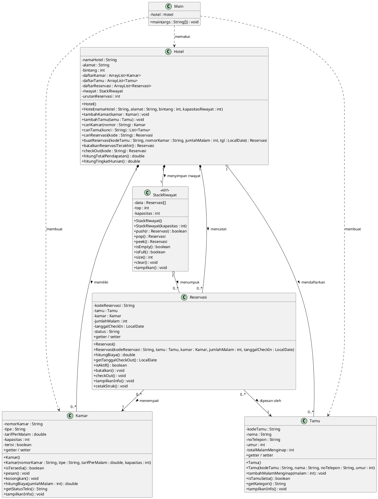

# UTS Object Oriented Programming — Aplikasi Manajemen Hotel Mini

| | |
|---|---|
| **Nama** | Tirta Apriliansyah |
| **NIM** | 22515065 |
| **Dosen** | Muhammad Avied Bachmid, S.Kom., M.Kom. |
| **Topik (digit terakhir NIM = 5)** | Hotel (Kamar, Tamu, Reservasi, Hotel) |
| **ADT (digit ke-2 dari belakang = 6; 6 mod 3 = 0)** | Stack (riwayat reservasi, fitur batalkan reservasi terakhir) |
| **Invariant wajib** | Kamar terisi tidak bisa dipesan; biaya = tarif x malam |

## 1. Cara Menjalankan

Syarat: JDK 11 atau lebih baru.

```bash
# dari folder root project
mkdir out
javac -d out src/hotel/*.java
java -cp out hotel.Main
```

Menjalankan skenario uji otomatis (tanpa mengetik manual), untuk tangkapan layar:

```bash
java -cp out hotel.Main < tests/input_B.txt     # contoh: stack penuh
```

Tip cepat: pilih menu **14** (data contoh) agar langsung terisi 6 kamar dan 3 tamu.

## 2. Struktur Project

```
UTS-POO_22515065_TirtaApriliansyah/
├── src/hotel/
│   ├── Main.java          # menu console + validasi input
│   ├── Hotel.java         # pengelola utama + aturan bisnis
│   ├── Kamar.java         # entitas 1
│   ├── Tamu.java          # entitas 2
│   ├── Reservasi.java     # entitas 3 (transaksi utama)
│   ├── StackRiwayat.java  # ADT Stack berbasis array
│   └── FormatUtil.java    # format rupiah dan tanggal
├── tests/                 # input skenario uji (input_A ... input_F)
├── .gitignore
└── README.md
```

Jumlah class: 7 (4 entitas: Kamar, Tamu, Reservasi, Hotel; 1 ADT: StackRiwayat; 1 Main; 1 utilitas).

## 3. Bahan Bab 1 — Analisis OOP

**Deskripsi sistem.** Aplikasi console untuk hotel kecil: mencatat kamar dan tamu, membuat reservasi, check-out, pencarian data, laporan ringkasan, dan membatalkan reservasi terakhir dengan Stack. Masalah yang diselesaikan: pencatatan manual rawan kamar dipesan ganda dan salah hitung biaya.

**Objek dunia nyata menjadi class.**

| Class | Alasan |
|---|---|
| Kamar | Benda nyata yang disewakan; punya nomor, tipe, tarif, status terisi |
| Tamu | Pelanggan; punya identitas dan riwayat menginap |
| Reservasi | Transaksi yang menghubungkan Tamu dan Kamar; punya lama menginap, status, biaya |
| Hotel | Pengelola yang memegang semua kamar, tamu, reservasi dan menegakkan aturan |
| StackRiwayat | Struktur data LIFO untuk fitur batalkan reservasi terakhir |

**Prosedural vs OOP.** Pada prosedural, data kamar/tamu disimpan di array terpisah (`String[] nomorKamar`, `double[] tarif`, `boolean[] terisi`) dan fungsi-fungsi lepas mengubahnya; aturan "kamar terisi tidak boleh dipesan" harus diingat dan ditulis ulang di setiap fungsi. Pada OOP, data dan aturan dibungkus dalam satu objek: `Kamar.pesan()` sendiri menolak bila kamar terisi, sehingga aturan tidak mungkin terlewat. Keuntungan: aturan terpusat, kode lebih mudah dirawat, dan penambahan fitur (misal tipe kamar baru) tidak merusak bagian lain.

**Abstraksi.** Pengguna `Hotel` cukup memanggil `buatReservasi(...)` tanpa tahu detail pengecekan, penandaan kamar, dan push stack. `StackRiwayat` juga abstraksi: pemakai hanya mengenal push/pop/peek, bukan array dan indeks `top`.

**Enkapsulasi.** Semua atribut `private`; akses lewat getter/setter; setter memvalidasi (tarif > 0, umur 17-120, jumlah malam > 0, dst.); daftar di `Hotel` dikembalikan sebagai `unmodifiableList`.

**Dua prinsip lain (hanya disebut).** Pewarisan (inheritance) dan polimorfisme (polymorphism) belum dipakai karena belum menjadi cakupan UTS.

## 4. Bahan Bab 2 — Class Diagram

Buat ulang di draw.io, atau tempel kode PlantUML berikut ke https://www.plantuml.com/plantuml untuk hasil cepat.



**Penjelasan relasi dan multiplicity.**

| Relasi | Jenis | Multiplicity | Penjelasan |
|---|---|---|---|
| Hotel — Kamar | Komposisi | 1 ke 0..* | Kamar tidak bermakna tanpa hotel |
| Hotel — Reservasi | Komposisi | 1 ke 0..* | Reservasi dicatat dan dimiliki hotel |
| Hotel — Tamu | Agregasi | 1 ke 0..* | Tamu adalah orang yang berdiri sendiri, hanya didaftarkan |
| Hotel — StackRiwayat | Komposisi | 1 ke 1 | Stack dibuat dan dihapus bersama hotel |
| Reservasi — Tamu | Asosiasi | banyak ke 1 | Satu tamu bisa punya banyak reservasi |
| Reservasi — Kamar | Asosiasi | banyak ke 1 | Satu kamar bisa muncul di banyak reservasi pada waktu berbeda |
| StackRiwayat — Reservasi | Agregasi | 1 ke 0..* | Stack menyimpan referensi reservasi |
| Main — Hotel/Kamar/Tamu | Dependensi | - | Main hanya memakai |

## 5. Bahan Bab 4 — Spesifikasi ADT Stack

| Operasi | Parameter | Kembalian | Prasyarat | Efek |
|---|---|---|---|---|
| `push` | Reservasi r | boolean | r bukan null, stack tidak penuh | r di puncak, size + 1; false bila penuh/null |
| `pop` | - | Reservasi | stack tidak kosong | puncak dihapus, size - 1; null bila kosong |
| `peek` | - | Reservasi | stack tidak kosong | tidak ada perubahan; null bila kosong |
| `isEmpty` | - | boolean | - | true bila size = 0 |
| `isFull` | - | boolean | - | true bila size = kapasitas |
| `size` | - | int | - | mengembalikan jumlah elemen |
| `clear` | - | void | - | semua elemen dihapus |
| `tampilkan` | - | void | - | mencetak isi dari TOP ke BOTTOM |

**Ilustrasi (kapasitas 5).** Setelah push RSV-001, RSV-002, RSV-003:

```
 indeks 4 | (kosong)
 indeks 3 | (kosong)
 indeks 2 | RSV-003  <- top = 2
 indeks 1 | RSV-002
 indeks 0 | RSV-001
```
`pop()` mengembalikan RSV-003 (LIFO), `top` turun menjadi 1.

**Kompleksitas.** push, pop, peek, isEmpty, isFull, size: O(1). clear dan tampilkan: O(n). Ruang: O(k), k = kapasitas.

**Keputusan rancangan.** Bila stack penuh, reservasi baru ditolak (bukan diam-diam tanpa riwayat), supaya "batalkan reservasi terakhir" selalu membatalkan reservasi yang benar. Pengguna dapat memakai POP atau CLEAR untuk mengosongkan ruang.

## 6. Bahan Bab 5 — Tabel Skenario Uji

Seluruh hasil aktual di bawah berasal dari eksekusi program sungguhan (input ada di folder `tests/`). Tambahkan tangkapan layar sendiri untuk tiap skenario.

| No | Skenario | Input | Hasil diharapkan | Hasil aktual | Status |
|---|---|---|---|---|---|
| 1 | Normal: muat data contoh | Menu 14 | 6 kamar dan 3 tamu terisi | "Data contoh dimuat: 6 kamar dan 3 tamu baru" | Lulus |
| 2 | Normal: buat reservasi | Menu 5: T001, 101, 3 malam, 25-11-2026 | RSV-001, biaya 3 x 250.000 | Total Rp 750.000, check-out 28-11-2026 | Lulus |
| 3 | Normal: check-out | Menu 12: RSV-001 (6 malam) | Kamar tersedia, tamu naik kategori | Rp 1.500.000, kategori Gold (6 malam) | Lulus |
| 4 | Normal: cari tamu | Menu 7, jenis 2, kunci "budi" | Budi Santoso ditemukan | "Ditemukan: 1 tamu." | Lulus |
| 5 | Aturan: kamar terisi dipesan lagi | Menu 5: T002, kamar 101 (sudah dipesan) | Ditolak | "[GAGAL] Kamar 101 sedang terisi dan tidak dapat dipesan." | Lulus |
| 6 | Aturan: tarif tidak positif | Menu 1: tarif 0 | Ditolak | "[GAGAL] Tarif per malam harus lebih dari 0." | Lulus |
| 7 | Aturan: jumlah malam 0 | Menu 5: malam 0 | Ditolak | "[GAGAL] Jumlah malam harus lebih dari 0." | Lulus |
| 8 | Aturan: umur di luar rentang | Menu 3: umur 10 | Ditolak | "[GAGAL] Umur tamu harus antara 17 sampai 120 tahun." | Lulus |
| 9 | ADT penuh | 5 reservasi lalu reservasi ke-6 (kamar 301) | Ditolak, program tetap jalan | "[GAGAL] Riwayat reservasi (stack) penuh, kapasitas 5..." | Lulus |
| 10 | ADT kosong: POP | Menu 8 saat stack kosong | Pesan error, tidak crash | "[GAGAL] Riwayat kosong: tidak ada reservasi yang dapat dibatalkan." | Lulus |
| 11 | ADT kosong: PEEK | Menu 9 saat stack kosong | Pesan info | "[INFO] Stack kosong: belum ada reservasi terakhir." | Lulus |
| 12 | Input tidak valid: huruf pada menu | Menu: `abc` | Diminta ulang | "[ERROR] Input harus berupa bilangan bulat..." | Lulus |
| 13 | Input tidak valid: huruf pada tarif | Tarif: `abc` | Diminta ulang | "[ERROR] Input harus berupa angka..." lalu prompt tarif muncul lagi | Lulus |
| 14 | Input tidak valid: tanggal tidak ada | Tanggal: `31-02-2026` | Diminta ulang | "[ERROR] Format tanggal salah atau tanggal tidak ada..." | Lulus |
| 15 | Input kosong | Menu 3: nama dikosongkan | Ditolak | "[GAGAL] Nama tamu tidak boleh kosong." | Lulus |
| 16 | Normal: POP membatalkan reservasi | Menu 5 lalu menu 8 | Reservasi batal, kamar kembali tersedia | "RSV-001 ... dibatalkan. Kamar 101 kembali tersedia." | Lulus |

## 7. Rencana Commit Git (minimal 8 commit)

```bash
git init
git add .gitignore README.md
git commit -m "Tambah .gitignore dan README awal"

# (setelah menaruh class diagram di folder docs/)
git add docs
git commit -m "Tambah class diagram"

git add src/hotel/FormatUtil.java
git commit -m "Tambah FormatUtil untuk format rupiah dan tanggal"

git add src/hotel/Kamar.java src/hotel/Tamu.java
git commit -m "Tambah class entitas Kamar dan Tamu"

git add src/hotel/Reservasi.java
git commit -m "Tambah class Reservasi dan relasi ke Tamu dan Kamar"

git add src/hotel/StackRiwayat.java
git commit -m "Tambah ADT StackRiwayat berbasis array"

git add src/hotel/Hotel.java
git commit -m "Tambah class Hotel dengan aturan bisnis"

git add src/hotel/Main.java
git commit -m "Tambah menu console di Main"

git add tests
git commit -m "Tambah input skenario pengujian"

git branch -M main
git remote add origin https://github.com/<username>/UTS-POO_22515065_TirtaApriliansyah.git
git push -u origin main
git rev-parse --short HEAD     # hash commit terakhir untuk halaman sampul dan lampiran
```

## 8. Pernyataan Orisinalitas (untuk Lampiran)

> Saya, Tirta Apriliansyah (NIM 22515065), menyatakan bahwa project UTS Object Oriented Programming ini saya kerjakan sendiri dan memahami seluruh isinya, serta tidak menyalin dari karya mahasiswa lain. Apabila terbukti melanggar, saya bersedia menerima sanksi sesuai peraturan akademik.
